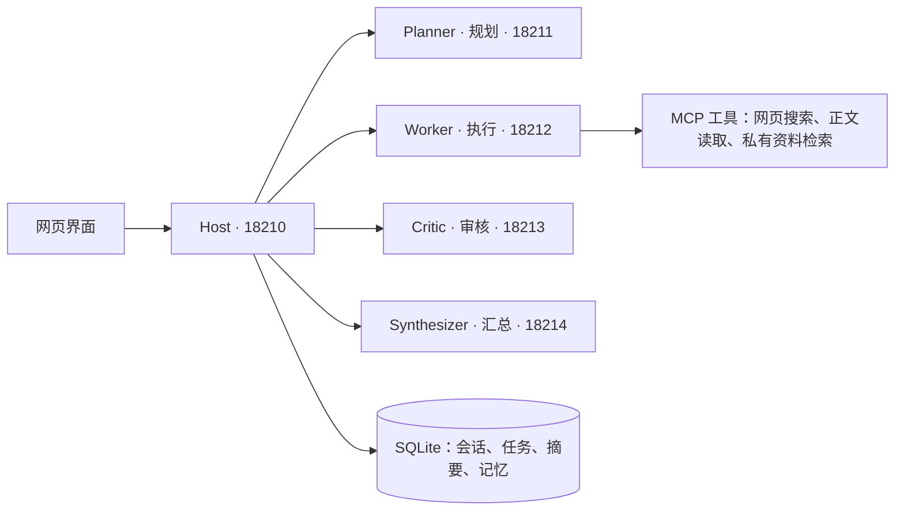

# NEWAgentGPT

NEWAgentGPT 是一个带网页界面的多智能体任务助手。输入目标后，它会拆分任务、调用工具查找资料、检查结果，再整理成答复。你可以查看执行进度，在同一会话里继续提问，也可以上传文档供它检索。

项目使用官方 A2A SDK 连接各个智能体，通过 MCP 调用工具。会话、任务和记忆保存在 SQLite 中，网页界面随服务一起启动。

## 工作方式

服务由五个独立进程组成：Host 接收请求并调度任务，Planner 制定计划，Worker 执行任务，Critic 检查结果和引用来源，Synthesizer 整理最终答复。



计划、已完成子任务和原运行标识通过 SQLite checkpoint 保存；连接异常有限重试后可暂停续答，复用已完成结果。

没有依赖关系的任务可以同时执行；需要上游结果的任务会等待。网页上可以查看任务状态和工具调用记录，也可以暂停、继续或停止当前任务。

## 快速开始

需要 Python 3.11 或更高版本，以及可用的 OpenAI 兼容模型服务。以下命令在 Linux 下执行。

### 安装

```bash
git clone https://github.com/sxxaysq/NEWAgentGPT.git
cd NEWAgentGPT
python -m venv .venv
source .venv/bin/activate
python -m pip install -e '.[dev]'
cp .env.example .env
```

### 配置

编辑 `.env`，先填写模型服务和进程间通信密钥：

| 配置项 | 填写内容 |
| --- | --- |
| `MODEL_BASE_URL` | 模型接口地址，例如 `http://127.0.0.1:8000/v1` |
| `MODEL_NAME` | 模型服务实际提供的模型名称 |
| `MODEL_API_KEY` | 模型服务的访问密钥；无需鉴权时可保留 `not-required` |
| `A2A_SECRET` | 自行生成的随机密钥，五个进程使用同一个值 |

其余配置可先保留示例值。需要网页搜索时，按网络环境填写 `SEARCH_PROXY`；使用 Tavily 搜索时填写 `TAVILY_API_KEY`。

### 启动

```bash
python scripts/a2a_ctl.py start
```

打开 <http://127.0.0.1:18210>，注册账号后新建目标。可以先试一句：“为 Python 初学者制定三步学习计划，每步包含一个练习。”

查看状态和停止服务：

```bash
python scripts/a2a_ctl.py status
python scripts/a2a_ctl.py stop
```

控制脚本默认将数据写入项目下的 `ui_data/`，日志写入 `logs/`。

<details>
<summary>Windows 手动启动</summary>

在项目目录中打开 PowerShell，安装依赖并复制配置文件：

```powershell
python -m venv .venv
.\.venv\Scripts\Activate.ps1
python -m pip install -e ".[dev]"
Copy-Item .env.example .env
```

按上表编辑 `.env`，并加入 `DATA_DIR=./ui_data`。下面每条命令各占一个终端；所有终端都在项目目录中运行，并先激活同一个虚拟环境。先启动四个智能体，最后启动 Host：

```powershell
python -m agentgpt --role worker
python -m agentgpt --role critic
python -m agentgpt --role synthesizer
python -m agentgpt --role planner
python -m uvicorn agentgpt.app:app --host 127.0.0.1 --port 18210
```

启动后同样访问 <http://127.0.0.1:18210>。停止时在各终端按 `Ctrl+C`。

</details>

## 资料与记忆

在“私有资料”中上传文档，等待处理完成，再在运行设置中选择知识库。支持 TXT、Markdown、CSV、JSON 和文本 PDF。`knowledge_base` 指定本次任务检索哪个知识库。

同一会话保留最近对话和滚动摘要。轻量记忆模式在开启后自动提取明确表达的长期偏好，同时支持显式保存、修改和删除；保存状态以 SQLite 事务回执为准。跨会话长期记忆默认关闭；需要使用时，在 `.env` 中设置 `MEMORY_ENABLED=true`，并在网页的“长期记忆”中开启。项目相关事实通过 `memory_scope` 区分，与知识库设置相互独立。

文档向量检索通过 `RAG_ENABLED=true` 开启。记忆和文档可分别配置 `MEMORY_EMBEDDING_URL`、`DOCUMENT_EMBEDDING_URL`；模型名称及向量维度需与对应服务一致。完整配置见 [`.env.example`](.env.example)。

## 目录说明

| 目录或文件 | 用途 |
| --- | --- |
| [`agentgpt/`](agentgpt/) | 网页界面、接口、智能体、任务调度、记忆和检索 |
| [`scripts/`](scripts/) | 服务管理、评测、报告生成和索引重建脚本 |
| [`tests/`](tests/) | 协议、调度、恢复、上下文、记忆及检索测试 |
| [`datasets/`](datasets/) | 100 个自然语言测试场景及验收要求 |
| [`docs/`](docs/) | 评测报告、完整答复和历史记录 |
| [`.env.example`](.env.example) | 模型、通信、记忆和检索配置示例 |
| [`pyproject.toml`](pyproject.toml) | 项目依赖及开发工具配置 |
| [`requirements.lock.txt`](requirements.lock.txt) | 固定版本的依赖清单 |
