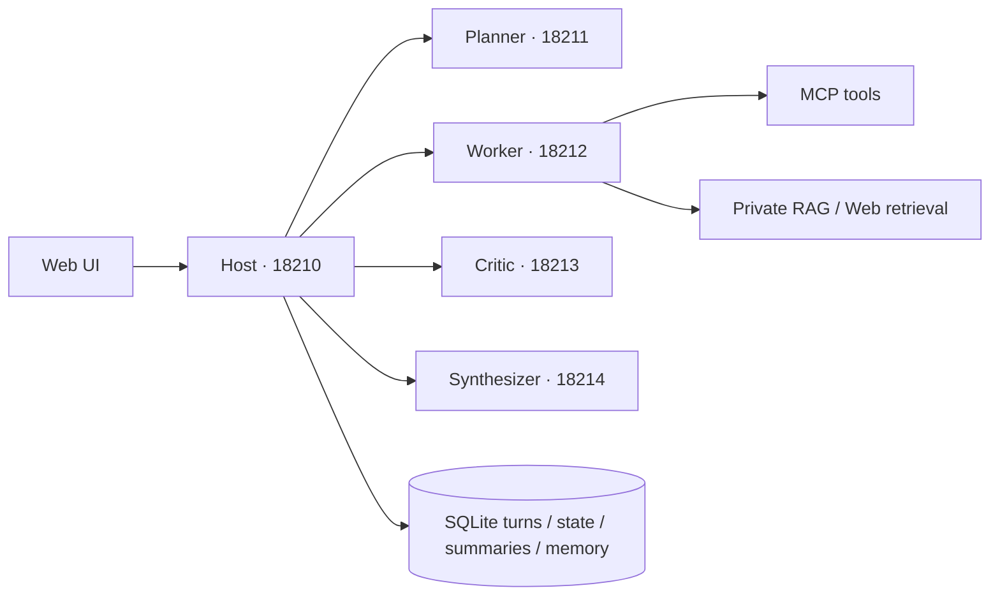

# NEWAgentGPT

基于官方 A2A SDK 的五进程 Agent 系统，提供网页界面、任务规划、工具执行、证据审核、答案合成、私有文档 RAG，以及可追溯的多轮上下文与长期记忆。

## 架构



Host 负责认证、持久命令队列、依赖调度、证据授权和终态事务。Planner 拆解任务；Worker 自主调用已授权工具；Critic 检查产物和来源；Synthesizer 形成最终答复。独立任务可以并发执行，依赖任务等待上游产物。

## 快速启动

要求 Python 3.11+。五进程控制脚本使用 Linux `/proc`；Windows 可分别启动各角色。

```bash
python -m venv .venv
source .venv/bin/activate
pip install -e '.[dev]'
cp .env.example .env
# 编辑 .env：设置模型服务、模型名和随机 A2A_SECRET
python scripts/a2a_ctl.py start
```

浏览器打开 `http://127.0.0.1:18210`，注册账号后创建任务。停止服务：`python scripts/a2a_ctl.py stop`。

手动运行角色：`python -m agentgpt --role planner`（另有 worker、critic、synthesizer）。Host 可使用 `uvicorn agentgpt.app:app --host 127.0.0.1 --port 18210`。同一部署的五个角色必须使用相同 DATA_DIR，手动启动时请自行在环境中设置；控制脚本默认使用项目下的 ui_data。

MCP 内置工具提供网页搜索、网页正文读取、私有文档搜索和原文读取。网页访问需要可用网络；可配置 `SEARCH_PROXY`、`TAVILY_API_KEY`。上传文档后等待入库完成，再选择对应知识库。

## 记忆与上下文

- 原始用户轮次、会话状态、历史摘要、跨会话记忆分开保存；关闭长期记忆仍保留本会话连续性。
- 请求先落库，完成状态和派生任务原子提交。摘要及状态有来源、版本和连续覆盖范围；异步滞后由原文增量补偿。
- `memory_scope` 是项目记忆范围，`knowledge_base` 是文档范围，两者独立；项目事实需要明确 memory_scope。
- 记忆使用 Dense + FTS5 trigram + 编号候选并集，可选重排。权限和版本在召回、恢复及新角色下发时复核。
- `context_ids` 用于授权用户原话与记忆；`evidence_ids` 用于本轮文档或网页证据，不能混用。
- 模型请求发送前检查完整输入预算。配置 `MODEL_TOKENIZER_URL` 使用模型服务计数；未配置时明确使用估算模式，不能视作严格 token 保证。

## 验证

```bash
python -m pytest -q
python -m ruff check agentgpt tests
python scripts/validate_memory_v3.py --output artifacts/contracts.json
# 以下会调用真实模型并创建合成测试账号/文档：
python scripts/validate_memory_live.py --base http://127.0.0.1:18210
python scripts/benchmark_live_100.py --output artifacts/live100 --parallel 3
```

应用版本通过本地及 Linux 服务器各 191 项回归；加入评测采集器回归后，发布包本地 **192 项测试全部通过**。100 场景真实执行结果及各类代表案例见 [执行报告](docs/LIVE100_REPORT.md)。无模型调用的契约测试与真实 API 场景分开统计，确定性断言不替代完整语义评审。

## 已知边界

超长必需输入会明确要求拆分，尚未自动分块转换；API 单次输入上限为 8000 字符。摘要来源检查不能保证语义完全正确。自动容量/时间归档尚未启用。暂停/继续测试不能替代 SIGKILL 故障注入；独立恢复单测覆盖进程崩溃和工具回执复用。

部署数据、用户文档、密钥、模型权重和运行数据库均不在此仓库中。SQLite 是权威记录，向量索引可重建；更新前请备份源码、配置、业务数据库及各角色 TaskStore。

真实评测自动断言通过 **96/100**；其中 1 个未通过经人工复核为断言误报，另有 3 个实际运行失败/超时。共173轮、910个A2A任务、443次工具回执记录。详见报告中的统计口径与失败记录。
